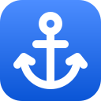

<p align="center"></p>

<h1 align="center">Dockside</h1>

<p align="center"><strong>Leave a tab. It docks.</strong></p>

<p align="center">
  
  
  
  
  <a href="LICENSE"></a>
</p>

<p align="center">
  <a href="#install">Install</a> ·
  <a href="#what-you-get">Features</a> ·
  <a href="#keys">Keys</a> ·
  <a href="#how-it-works">How it works</a> ·
  <a href="#development">Development</a>
</p>

<p align="center"></p>

Your tab strip fills up with tabs you're not using but don't want to lose. Dockside clears them out as you go. When you switch away from a tab, it docks in Chrome's side panel as an app. Dock a second tab from the same site and the app becomes a folder.

Nothing is closed. Docked tabs wait in one collapsed tab group, still loaded, so opening one brings it straight back with its scroll position, half-typed form, and login intact.

## Install

Dockside isn't on the Chrome Web Store yet. Load it unpacked:

```sh
git clone https://github.com/richdapice/dockside.git
```

1. Open `chrome://extensions` and turn on **Developer mode**.
2. Click **Load unpacked** and pick the `dockside` folder.
3. Press **Option+Shift+S** (Alt+Shift+S on Windows and Linux) or click the toolbar icon to open the panel. Press the
   shortcut again to close it.

## What you get

**A tab strip that only holds what you're using.** Switch tabs and the one you left docks after half a second. Close a tab yourself and it's gone, not docked.

**Apps and folders.** One tab from a site is an app. Point at it, or select it with the keyboard, and its page title appears. Two or more tabs become a folder with a count; open it to see every tab, how long ago you left it, and a × to drop it. A site with no icon gets a coloured letter, and names skip prefixes like `www.` and `m.`. The button beside the lock turns names off for a grid of just icons; point at one to see what it is. **Close all** in a folder, or the × on a tile, drops the whole site and closes its docked tabs.

**Tabs that don't reload.** Docked tabs live in a collapsed group at the end of the strip, its chip showing ⚓ and how many are inside. Click an app or a folder row and the live tab comes out. Expand the group and click a tab there, or drag it out, and that works too.

**Your arrangement.** Tiles are sorted newest first, by when you last left a tab from that site, so the tab you just left is up front. Drag a tile and it's pinned where you drop it, marked with a pin; everything else flows around it. Click the pin, or press P, to unpin.

**Back to your last tab.** Option+Shift+L flips to the tab you were on before, docked or not. Press it again to flip back.

**Bulk moves.** **Unload tabs** works like OneTab: it closes every tab in the ⚓ group to free memory, keeping them in the dock. The dock survives restarts, and opening an item loads it fresh from its address. **Clear dock** empties the dock and closes its tabs, after asking you to confirm.

**A panel that gets out of the way.** Opening a tab from the side panel closes the panel. Click the lock in its corner to keep it open instead.

**A window that stays open.** Each window keeps a pinned Dockside tab showing the launcher, so closing your last regular tab never closes the window. Its heading counts your docked tabs and how many are still loaded in the ⚓ group.

## Keys

| Where | Key | Does |
|---|---|---|
| Anywhere in Chrome | Option+Shift+S | Open or close the panel |
| Anywhere in Chrome | Option+Shift+L | Switch to the tab you used last |
| Grid | ← → ↑ ↓ | Move between tiles |
| Grid | Enter | Open an app, or open a folder |
| Grid | P | Pin the selected tile where it is, or unpin it |
| Grid | ↓ from the bottom row | Move to the buttons below the dock; ← → between them, ↑ back to the tiles |
| Folder | ↑ ↓ | Move between tabs |
| Folder | ↑ from the top row | Move to Back and Close all; ← → between them, ↓ back to the tabs |
| Folder | Enter | Bring that tab back |
| Folder | Esc, ← | Back to the grid |
| Grid or folder | Delete (delete on a Mac) | Remove the selected item, closing its docked tabs |

On Windows and Linux, Option is Alt. Change the shortcuts at `chrome://extensions/shortcuts`.

## What never docks

- Pinned tabs, tabs playing audio, and incognito tabs.
- Tabs in a group you made. Your groups stay yours.
- Pages that aren't web pages: `chrome://` pages, the New Tab page, extension pages.

## How it works

- **The dock** is a list in `chrome.storage.local`: URL, title, site, when you left it, and the live tab's id. Pins are saved alongside it as site → position.
- **The ⚓ group** is tracked by id, so a group of your own that happens to have a similar title is left alone. After a browser restart, ids change: Dockside takes back restored ⚓ groups that hold docked pages and matches their tabs to dock items by URL. If a tab is gone, its app opens the URL fresh instead.
- **Pages that move:** a docked page can still navigate (redirects, single-page apps). Its dock item follows the tab's address, so it reopens what the tab shows.
- **Duplicates:** docking a page that's already in the dock keeps only the newer tab.

Permissions: `tabs` and `tabGroups` to move tabs in and out of the group, `storage` for the dock, `sidePanel` for the launcher, `favicon` for site icons. No host permissions; Dockside never reads page content.

## Development

No build step and no runtime dependencies. Edit the files, then click reload on the extension in `chrome://extensions`.

```sh
npm test                                     # unit tests for the dock logic (Node 22+)
npm install && npx playwright install chromium
npm run e2e                                  # end-to-end tests in Playwright's Chromium, about 40 seconds
HEADED=1 npm run e2e                         # the same, with the browser visible
```

The end-to-end tests load the extension and drive real tabs and groups, with the launcher open as a tab, since
automation can't open the side panel. The two keyboard shortcuts need real key presses, so check those by hand.

## License

[MIT](LICENSE)
